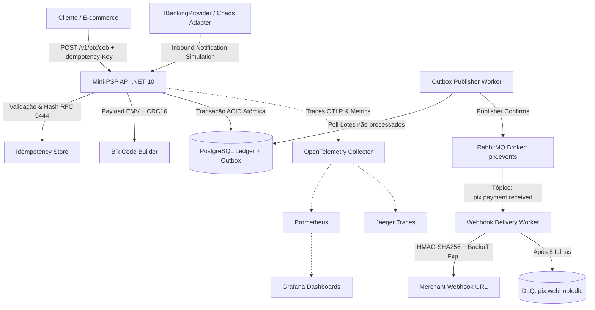

# Mini-PSP Pix Simulado

> **Um Payment Service Provider (PSP) Pix simulado, construído em .NET 10, cobrindo os pilares críticos de engenharia de software para fintechs e sistemas de pagamentos de alta escala.**

Projetado para demonstrar domínio prático de:
- **BR Code EMV e CRC16** conforme especificação pública do Banco Central do Brasil (Bacen).
- **Provedor Bancário Simulado (`IBankingProvider`)** com injeção de caos (delays, timeouts, falhas e notificações duplicadas).
- **Idempotência Rigorosa (RFC 9444 / IETF)** com resposta repetível em cache e detecção de payloads conflitantes.
- **Ledger de Dupla Entrada (Double-Entry Ledger)** com **testes comparativos de concorrência** demonstrando o bug de *Double-Spending* e a correção via controle otimista (`RowVersion`).
- **Transactional Outbox Pattern** com publicação resiliente no RabbitMQ.
- **Webhooks Assinados com HMAC-SHA256**, backoff exponencial e Dead Letter Queue (DLQ).
- **Observabilidade Completa** (OpenTelemetry, Prometheus, Grafana, Jaeger) e **Teste de Carga com k6**.
- **Cobertura de Testes Superior a 80%** (85.3% medido via Coverlet).

---

## 🏛️ Arquitetura do Sistema



---

## ⚡ Quickstart em 2 Minutos

### 1. Rodar Todos os Testes Automatizados (Sem Dependências Externas)
Toda a suíte de testes unitários, de concorrência e de integração funciona **100% de forma isolada** usando provedores em memória:

```bash
dotnet test
```

### 2. Rodar a Cobertura de Código (Mínimo de 80% Garantido)
```bash
dotnet test --settings coverlet.runsettings --collect:"XPlat Code Coverage"
```
> **Resultado Atual**: **85.3%** de cobertura global (**95.1% na API**, **86.0% no Domínio**, **83.6% na Aplicação**).

### 3. Subir o Ecossistema Completo com Docker Compose
PostgreSQL, RabbitMQ com Management, OpenTelemetry Collector, Prometheus, Jaeger, Grafana e API:

```bash
docker compose up -d
```

| Serviço | URL | Credenciais |
| :--- | :--- | :--- |
| **Mini-PSP API** | `http://localhost:5000` | - |
| **OpenAPI Spec** | `http://localhost:5000/openapi/v1.json` | - |
| **RabbitMQ Management** | `http://localhost:15672` | `guest` / `guest` |
| **Grafana Dashboards** | `http://localhost:3000` | `admin` / `admin` |
| **Prometheus Metrics** | `http://localhost:9090` | - |
| **Jaeger Traces UI** | `http://localhost:16686` | - |

---

## 🔍 Os 7 Pilares Demonstrados

### 1. Cobrança Imediata & BR Code EMV (Bacen Pix)
- Implementação estrita do manual de iniciação do Pix do Banco Central do Brasil.
- Tags EMVCo: `00` (Formato), `01` (Iniciação), `26` (Merchant Account com GUI `br.gov.bcb.pix`), `52` (MCC `0000`), `53` (Moeda `986` - BRL), `54` (Valor formatado), `58` (`BR`), `59` (Nome sanitizado), `60` (Cidade sanitizada), `62` (`TxId`) e `63` (`CRC16`).
- **Algoritmo CRC16-CCITT puro** (Polinômio `0x1021`, inicial `0xFFFF`), validado contra os vetores de teste públicos do Bacen (`D3E6`).
- Geração instantânea de SVG vetorial responsivo para renderização direta em navegadores.

### 2. Provedor Bancário Simulado (`IBankingProvider`) com Injeção de Caos
- Interface `IBankingProvider` com adaptador desacoplado `SimulatedBankingProvider`.
- Permite injetar comportamentos anômalos em tempo de execução via `ChaosOptions`:
  - `Delay`: Latência artificial para teste de resiliência e SLAs de clientes.
  - `Timeout`: Lança `TimeoutException` simulando interrupção de socket com a câmara SPI.
  - `Fail`: Simula códigos de erro do Bacen (ex: `AB03` para chave inexistente).
  - `Duplicate`: Dispara duas notificações de liquidação quase simultâneas para validar que o PSP absorve duplicatas sem duplicar créditos contábeis.

### 3. Idempotência Rigorosa (RFC 9444)
- Middleware intercepta o header `Idempotency-Key`.
- Gera hash determinístico SHA-256 com canonicidade de JSON (chaves ordenadas alfabeticamente).
- **Replay Idêntico**: Mesma chave e mesmo payload retorna o resultado gravado com o header `Idempotent-Replay: true`.
- **Detecção de Conflito**: Mesma chave reutilizada com payload alterado rejeita com `422 Unprocessable Entity`.
- **Proteção Concorrente**: Bloqueio com status `InProgress` para evitar processamento paralelo duplicado (`409 Conflict`).

### 4. Ledger de Dupla Entrada & Teste Comparativo de Concorrência
O princípio contábil bancário onde nenhuma quantia é criada ou destruída ($\sum \text{Débitos} = \sum \text{Créditos}$):
- Conta Transitória Bacen (`PixSettlementTransit`) e Saldo Disponível (`MerchantAccount`).
- **Suíte de Testes Comparativa Verificável**:
  - `WithoutConcurrencyControl_TwoParallelRequests_ShouldBothSpendSameBalance_CausingDoubleSpending`: Demonstra a condição de corrida em sistemas ingênuos, onde duas requisições paralelas gastam os mesmos R$ 100,00 de um saldo de R$ 100,00.
  - `WithOptimisticConcurrencyControl_ParallelDebits_ShouldPreventDoubleSpending`: Prova que com a correção via controle de versão de linha (`RowVersion`), 10 requisições simultâneas resultam em **exatamente 1 aprovação e 9 rejeições**, garantindo que o saldo final termine rigorosamente em **R$ 0,00** e o balanço do ledger feche em zero.

### 5. Transactional Outbox Pattern & Filas RabbitMQ
- Resolve o problema de escrita dupla (*dual-write problem*): a cobrança e o evento de domínio (`pix.charge.created`, `pix.payment.received`, `pix.payout.completed`) são persistidos na **mesma transação ACID** no PostgreSQL.
- O `OutboxPublisherWorker` (`BackgroundService`) lê os lotes em segundo plano, publica no RabbitMQ com **Publisher Confirms** e marca as mensagens como processadas.

### 6. Webhooks com Assinatura HMAC-SHA256, Retry Exponencial e DLQ
- Notificação de eventos para os lojistas cadastrados com cabeçalho de assinatura digital:
  `X-Signature: t={timestamp},v1={hmac_sha256}`
- Proteção contra *tampering* e *replay attacks* com janela de tolerância de 5 minutos.
- Em caso de falha do endpoint de destino, o `WebhookDeliveryWorker` executa retentativas com **backoff exponencial** ($2^0 \times 2s, 2^1 \times 2s, 2^2 \times 2s \dots$).
- Após 5 falhas consecutivas, a mensagem é encaminhada para a **Dead Letter Queue (`pix.webhook.dlq`)**.

### 7. Observabilidade e Teste de Carga (k6)
- Instrumentação nativa OpenTelemetry com métricas personalizadas:
  - `pix_charges_created_total`
  - `pix_payments_received_total`
  - `pix_payouts_processed_total`
  - `pix_idempotency_hits_total`
- Script de estresse com k6 (`load-tests/k6-charges-load.js`) pronto para rodar:
  ```bash
  docker run --rm -i --net=host grafana/k6 run - < load-tests/k6-charges-load.js
  ```

---

## 🧪 Estrutura da Solução

```
mini-psp-pix-simulado/
├── MiniPspPix.sln
├── Dockerfile
├── docker-compose.yml
├── coverlet.runsettings
│
├── src/
│   ├── MiniPspPix.Domain/          # Entidades puras, Value Objects e IBankingProvider
│   ├── MiniPspPix.Application/     # BR Code EMV, CRC16, HMAC, Idempotência e Use Cases
│   ├── MiniPspPix.Infrastructure/  # EF Core, Repositórios, RabbitMQ, Workers e Provedor Simulado
│   └── MiniPspPix.Api/             # Minimal APIs, Middlewares e OpenTelemetry
│
├── tests/
│   ├── MiniPspPix.UnitTests/       # 53 testes unitários (BR Code, CRC16, HMAC, Idempotência)
│   ├── MiniPspPix.ConcurrencyTests/# Testes de Race Condition vs. Controle Otimista
│   └── MiniPspPix.IntegrationTests/# 15 testes de integração end-to-end com WebApplicationFactory
│
├── load-tests/
│   ├── k6-charges-load.js          # Script de carga distribuída k6
│   └── README.md                   # Instruções e métricas de benchmark
│
└── observability/
    ├── otel-collector-config.yaml  # Configuração do OTel Collector
    ├── prometheus.yml              # Scraping de métricas
    └── grafana/                    # Dashboards e datasources pré-provisionados
```

---

## 📌 Exemplos de Uso da API

### Criar Cobrança Pix com BR Code
```bash
curl -X POST http://localhost:5000/v1/pix/cob \
  -H "Content-Type: application/json" \
  -H "Idempotency-Key: cob-req-001" \
  -d '{
    "amount": 150.00,
    "pixKey": "lojista@empresa.com",
    "description": "Pedido #1024",
    "merchantName": "LOJA VIRTUAL",
    "merchantCity": "SAO PAULO"
  }'
```

### Simular Liquidação Bancária (Inbound Pix)
```bash
curl -X POST http://localhost:5000/v1/pix/simulation/inbound-payment \
  -H "Content-Type: application/json" \
  -d '{
    "txId": "SEU_TXID_AQUI",
    "amount": 150.00
  }'
```

### Consultar Saldo no Ledger
```bash
curl http://localhost:5000/v1/ledger/accounts/22222222-2222-2222-2222-222222222222/balance
```

---

## 👨‍💻 Autor
Desenvolvido por **Marcos W. Ferreira** como projeto de referência arquitetural para sistemas de pagamentos de missão crítica.
