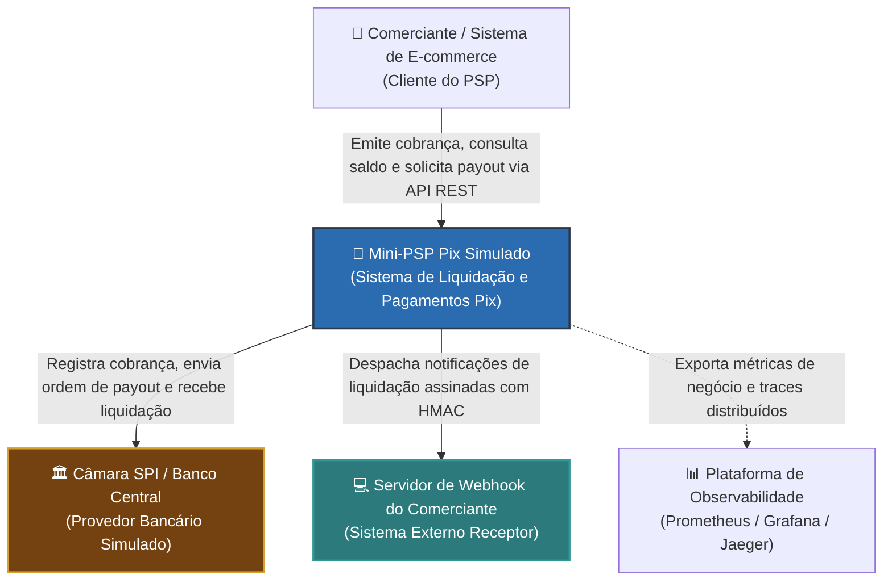
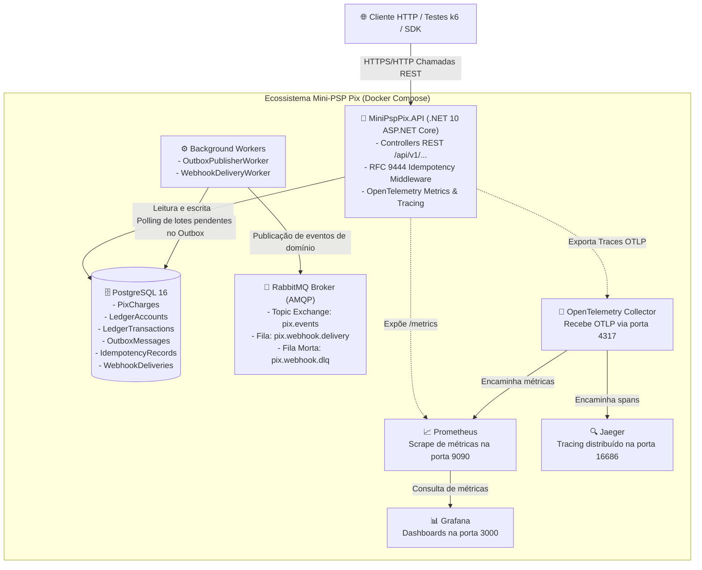
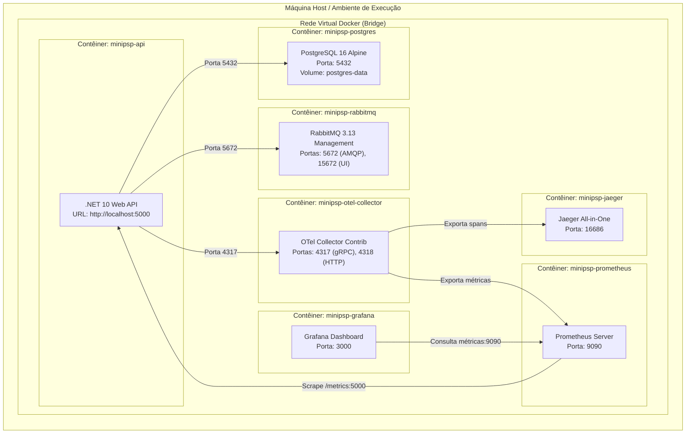

# Modelo C4 (C4 Model) de Arquitetura

O modelo C4 descreve a arquitetura do **Mini-PSP Pix Simulado** em quatro níveis progressivos de abstração: Contexto, Contêineres, Componentes e Implantação.

---

## 🌐 Nível 1: Diagrama de Contexto (System Context)

Apresenta como os usuários (Comerciantes e E-commerces) e sistemas externos (Câmara SPI Bacen e Endpoints de Webhook) interagem com o Mini-PSP Pix.

---

## 📦 Nível 2: Diagrama de Contêineres (Container Diagram)

Apresenta as aplicações executáveis, bancos de dados e sistemas de mensageria que compõem o ecossistema.

---

## 🧩 Nível 3: Diagrama de Componentes (Component Diagram - API & Application)

Detalha os blocos internos presentes na solução .NET e como as requisições fluem através dos casos de uso e serviços de domínio.

```mermaid
flowchart TD
    subgraph Presentation ["Camada de Apresentação (MiniPspPix.API)"]
        IdempMw["IdempotencyMiddleware\n(RFC 9444)"]
        ChargesCtrl["ChargesController\n(/api/v1/charges)"]
        PaymentsCtrl["PaymentsController\n(/api/v1/payments/simulation)"]
        PayoutCtrl["PayoutController\n(/api/v1/payout)"]
        LedgerCtrl["LedgerController\n(/api/v1/ledger)"]
        ExHandler["ExceptionHandler\n(ProblemDetails RFC 7807)"]
        Metrics["PixMetrics\n(System.Diagnostics.Metrics)"]
    end

    subgraph ApplicationLayer ["Camada de Aplicação (Application)"]
        CreateCobUC["CreatePixChargeUseCase"]
        PaySimUC["ProcessInboundPaymentUseCase"]
        PayoutUC["RequestPayoutUseCase"]
        LedgerUC["GetAccountBalanceUseCase\nGetAccountStatementUseCase"]
        WebhookUC["RegisterWebhookUseCase\nDispatchWebhookUseCase"]
    end

    subgraph DomainAndInfra ["Domínio e Infraestrutura"]
        BrCodeSvc["BrCodeService\n(EMV TLV & CRC16-CCITT)"]
        HmacSvc["HmacSignerService\n(HMAC-SHA256)"]
        BankProv["SimulatedBankingProvider\n(Chaos Injection SPI)"]
        LedgerRepo["LedgerRepository\n(Double-Entry & RowVersion)"]
        ChargeRepo["ChargeRepository"]
        OutboxRepo["OutboxRepository"]
        IdempStore["IdempotencyStore"]
    end

    IdempMw --> IdempStore
    IdempMw --> ChargesCtrl
    IdempMw --> PayoutCtrl

    ChargesCtrl --> CreateCobUC
    PaymentsCtrl --> PaySimUC
    PayoutCtrl --> PayoutUC
    LedgerCtrl --> LedgerUC

    CreateCobUC --> BrCodeSvc
    CreateCobUC --> ChargeRepo
    CreateCobUC --> OutboxRepo

    PaySimUC --> BankProv
    PaySimUC --> ChargeRepo
    PaySimUC --> LedgerRepo
    PaySimUC --> OutboxRepo

    PayoutUC --> LedgerRepo
    PayoutUC --> BankProv
    PayoutUC --> OutboxRepo

    ChargesCtrl -.-> Metrics
    PaymentsCtrl -.-> Metrics
    PayoutCtrl -.-> Metrics
    ExHandler -.-> Metrics
```

---

## 🚀 Nível 4: Diagrama de Implantação (Deployment Diagram)

Apresenta a topologia de nós e contêineres gerenciados pelo `docker-compose.yml`:

