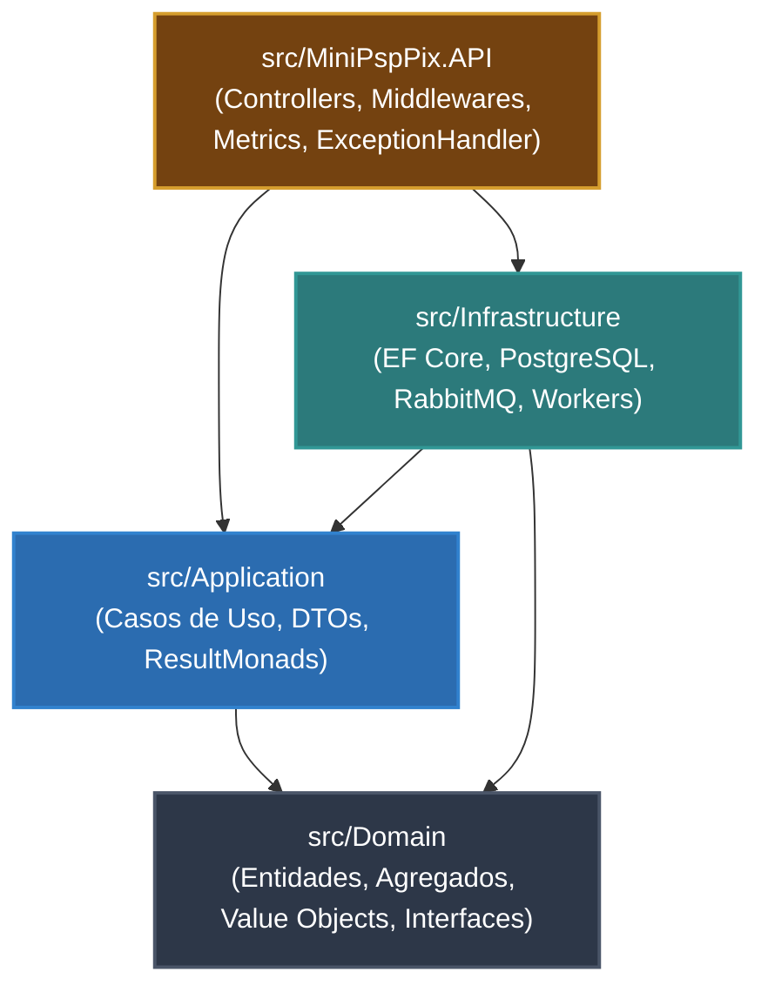

# Arquitetura Limpa (Clean Architecture) & DDD

O **Mini-PSP Pix Simulado** foi concebido sob os princípios da **Clean Architecture** (Robert C. Martin) combinados com práticas essenciais de **Domain-Driven Design (DDD)**, seguindo a estrutura modular refinada do projeto [18SOAT_TechChallenge](https://github.com/marcoswferreira/18SOAT_TechChallenge).

---

## 🏛️ Princípio de Inversão de Dependência

Todas as dependências apontam para o centro. As camadas de domínio e aplicação não conhecem detalhes de infraestrutura (bancos de dados, brokers de mensageria, protocolos HTTP ou SDKs externos).

---

## 📦 Detalhamento das Camadas

### 1. `src/Domain` (Núcleo do Domínio)
Contém toda a lógica de negócio intrínseca, livre de qualquer dependência externa ou referências a pacotes de infraestrutura.
* **Agregados e Entidades (`Domain.Entities`)**:
  * `PixCharge`: Ciclo de vida da cobrança Pix (`Active`, `Completed`, `Expired`), data de expiração, associação a TxId, BR Code e EndToEndId.
  * `LedgerAccount`: Conta contábil (`PixSettlementTransit` ou `Merchant`), saldo, moeda e controle de versão concorrente (`uint Version`).
  * `LedgerTransaction` & `LedgerEntry`: Registro imutável de partidas dobradas garantindo validação estrita de balanço ($\sum \text{Débitos} = \sum \text{Créditos}$).
  * `OutboxMessage`: Registro atômico de eventos a serem despachados para o broker.
  * `WebhookSubscription` & `WebhookDelivery`: Gerenciamento de destinos, chave secreta HMAC, contador de tentativas e transição para Dead Letter Queue (DLQ).
  * `IdempotencyRecord`: Chave RFC 9444, hash canônico, status (`InProgress`, `Completed`) e cache de resposta HTTP.
* **Value Objects (`Domain.ValueObjects`)**:
  * `PixKey`: Chave Pix validada e tipada (CPF, CNPJ, E-mail, Telefone, Chave Aleatória/EVP).
  * `TxId`: Identificador de transação (1 a 35 caracteres alfanuméricos válidos).
  * `EndToEndId`: Identificador fim-a-fim gerado segundo o padrão do Bacen (`E{ISPB}{Timestamp}{Random}`).
* **Interfaces de Serviços e Repositórios (`Domain.Interfaces.*`)**:
  * `IChargeRepository`, `ILedgerRepository`, `IOutboxRepository`, `IWebhookRepository`, `IIdempotencyStore`.
  * `IBankingProvider`, `IBrCodeService`, `IHmacSignerService`, `IWebhookSenderClient`.

### 2. `src/Application` (Casos de Uso e Orquestração)
Define o comportamento do sistema orquestrando as entidades de domínio e as interfaces de repositórios.
* **Casos de Uso (`Application.UseCases.*`)**:
  * `CreatePixChargeUseCase`: Valida dados, gera BR Code EMV, calcula CRC16, renderiza SVG do QR Code, salva cobrança e enfileira mensagem no Outbox.
  * `GetPixChargeByTxIdUseCase`: Recupera cobrança por TxId e mapeia para DTO.
  * `ProcessInboundPaymentUseCase`: Simula liquidação via provedor bancário, atualiza status da cobrança para paga, executa transferência contábil no Ledger e emite evento Outbox.
  * `RequestPayoutUseCase`: Executa validação de saldo, saque bancário e transferência a débito do comerciante e a crédito da conta transitória do Bacen.
  * `GetAccountBalanceUseCase` & `GetAccountStatementUseCase`: Consulta saldo e extrato contábil no Ledger.
  * `RegisterWebhookUseCase` & `DispatchWebhookUseCase`: Cadastro de URLs parceiras e envio com assinatura HMAC.
* **DTOs e Monad Result (`Application.Dto`)**:
  * `Result` e `ResultGeneric<T>`: Encapsulam sucesso/falha e lista de erros para evitar exceções de fluxo e padronizar as respostas.

### 3. `src/Infrastructure` (Implementação de Recursos Técnicos)
Materializa os acessos externos e persistência.
* **Persistência (`Infrastructure.Database.*`)**:
  * `ApplicationDbContext`: DbContext do EF Core compatível tanto com PostgreSQL quanto InMemory.
  * `EntityMappings`: Configurações `IEntityTypeConfiguration<T>` declarativas com chaves primárias, índices únicos (como `TxId` e `Key`), limites de colunas e controle de concorrência com `IsRowVersion()`.
  * `Repositories`: Implementações concretas de todos os repositórios.
  * `DatabaseSeeder`: Carga inicial com contas de trânsito Bacen e conta de comerciante padrão.
* **Mensageria & Filas (`Infrastructure.Messaging`)**:
  * `IEventPublisher`: Interface para publicação de eventos.
  * `RabbitMqEventPublisher`: Implementação conectada via AMQP ao RabbitMQ com troca por tópicos (`ExchangeType.Topic`).
  * `InMemoryEventPublisher`: Alternativa em memória sem dependência externa, utilizada para testes de integração rápidos e isolados.
* **Background Workers (`Infrastructure.BackgroundWorkers`)**:
  * `OutboxPublisherWorker`: Processa lotes de mensagens pendentes na tabela de Outbox e envia ao broker.
  * `WebhookDeliveryWorker`: Realiza as tentativas de entrega de webhooks pendentes com backoff exponencial.
* **Serviços (`Infrastructure.Services`)**:
  * `SimulatedBankingProvider`: Adaptador que simula o Sistema de Pagamentos Instantâneos (SPI/Bacen) com injeção de caos.
  * `BrCodeService`: Implementação pura de formatação EMVCo e cálculo CRC16.
  * `HmacSignerService`: Assinatura criptográfica SHA-256 com carimbo de tempo.

### 4. `src/MiniPspPix.API` (Camada de Apresentação)
Ponto de entrada HTTP do sistema.
* **Controllers Versionados (`MiniPspPix.API.Controllers`)**:
  * `ChargesController` (`/api/v1/charges`): Emissão e consulta de cobranças Pix.
  * `PaymentsController` (`/api/v1/payments/simulation`): Simulação de recebimento bancário.
  * `PayoutController` (`/api/v1/payout`): Solicitação de transferências de saída.
  * `LedgerController` (`/api/v1/ledger/accounts/...`): Consulta de saldo e extratos contábeis.
  * `WebhooksController` (`/api/v1/webhooks`): Registro de webhook e endpoint de teste.
* **Middlewares & Filtros**:
  * `IdempotencyMiddleware`: Intercepta requisições com cabeçalho `Idempotency-Key` e assegura semântica RFC 9444.
  * `ExceptionHandler`: Implementação de `IExceptionHandler` gerando respostas padronizadas `ProblemDetails` (RFC 7807) para exceções de domínio e concorrência.
* **Métricas**:
  * `PixMetrics`: Métricas corporativas via `System.Diagnostics.Metrics` expostas no endpoint `/metrics` para coleta pelo Prometheus.

---

## 📄 Princípio de Single Type per File (Um Tipo por Arquivo)

Toda a base de código do projeto obedece rigorosamente ao padrão **Single Type per File**:
* Cada arquivo `.cs` contém **exclusivamente um único tipo top-level** (seja `class`, `interface`, `record`, `struct` ou `enum`).
* O nome do arquivo físico é **idêntico** ao identificador do tipo declarado (ex: `PixCharge.cs` declara apenas `class PixCharge`, `ChargeStatus.cs` declara apenas `enum ChargeStatus`, `IChargeRepository.cs` declara apenas `interface IChargeRepository`).
* DTOs de casos de uso (Inputs e Outputs) são segregados em arquivos individuais dentro de pastas `Dto/` dedicadas (ex: `CreatePixChargeInput.cs` e `PixChargeOutput.cs`).
* Mapeamentos do EF Core, repositórios, serviços de domínio e trabalhadores em background (`BackgroundService`) são todos desacoplados em arquivos autônomos.
* Essa disciplina elimina arquivos "balde" (como `Entities.cs`, `Enums.cs` ou `Services.cs`), facilita o rastreamento em Pull Requests, melhora a navegação em IDEs e potencializa a compilação paralela do Roslyn.

---

## 🧪 Estratégia de Testes

A organização de testes espelha rigorosamente as camadas da arquitetura:
1. `tests/Domain.UnitTests`: Testes rápidos, sem dependências ou mocks, validando invariantes matemáticas e regras puras.
2. `tests/Application.UnitTests`: Testes dos casos de uso e orquestrações utilizando a biblioteca `NSubstitute` para isolar repositórios e serviços.
3. `tests/IntegrationTests`: Testes de ponta a ponta com `CustomWebApplicationFactory`, testando os fluxos HTTP reais, concorrência no banco e middleware de idempotência.

