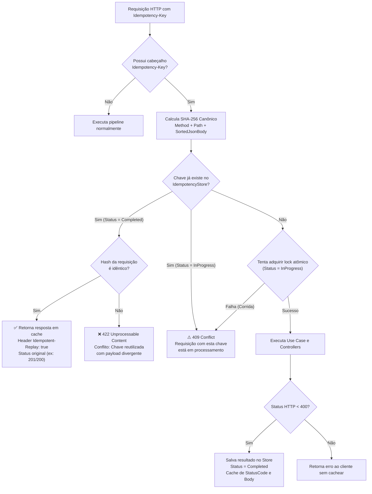

# Pilar 3: Idempotência Rigorosa (RFC 9444 / IETF)

Em APIs de pagamentos, quedas de conexão do cliente após o envio da requisição frequentemente levam a tentativas automáticas de retentativa (*retries*). Sem um mecanismo de idempotência robusto, o cliente corre o risco de sofrer **débito duplo** ou criar múltiplas cobranças indesejadas.

O **Mini-PSP Pix Simulado** adota integralmente a especificação **RFC 9444 ("The Idempotency-Key HTTP Header Field")** da IETF.

---

## 🔄 Fluxograma de Decisão do Middleware



---

## 🧩 Canonicidade de JSON & Fingerprinting SHA-256

Dois JSONs com os mesmos dados, porém com ordens de propriedades ou espaços diferentes, representam a **mesma intenção de negócio**:

```json
// Payload A
{
  "amount": 100.00,
  "pixKey": "teste@pix.com",
  "description": "Pagamento"
}

// Payload B (Chaves invertidas e formatação diferente)
{
  "description": "Pagamento",
  "pixKey": "teste@pix.com",
  "amount": 100.00
}
```

A classe `IdempotencyHasher`:
1. Faz o parse recursivo da árvore JSON (`JsonNode`).
2. Ordena alfabeticamente todas as chaves de objetos (`JsonObject`).
3. Serializa o JSON canônico sem indentação.
4. Gera o hash final:
   $$\text{Hash} = \text{SHA256}(\text{METODO} + \text{":"} + \text{ROTA} + \text{":"} + \text{JSON\_CANONICO})$$

Assim, `Payload A` e `Payload B` produzem rigorosamente o mesmo hash SHA-256, garantindo que o cliente receba o replay em cache mesmo que o seu client HTTP tenha serializado os campos em outra ordem.

---

## 🚦 Códigos de Status HTTP Conforme a RFC 9444

| Status Code | Situação | Significado na RFC 9444 |
| :--- | :--- | :--- |
| **`200 OK` / `201 Created`** | Primeira execução | Operação processada e gravada com sucesso. |
| **`200 OK` / `201 Created`** | Replay idêntico | Resposta entregue a partir do cache com o cabeçalho `Idempotent-Replay: true`. |
| **`409 Conflict`** | Requisição concorrente em andamento | Outra thread ou instância já está processando essa chave (`A request with this Idempotency-Key is currently in-flight`). |
| **`422 Unprocessable Content`** | Chave reutilizada com payload divergente | Violação da semântica da chave (`Idempotency-Key conflict: A request with this key already completed with different parameters`). |

---

## 🧪 Cobertura por Testes Automatizados

O comportamento de idempotência é auditado por 3 baterias de testes:
1. `Application.UnitTests/Services/HmacAndIdempotencyTests.cs`:
   Valida que objetos com chaves invertidas geram hashes idênticos e objetos alterados geram hashes diferentes.
2. `IntegrationTests/Concurrency/RaceConditionAndConcurrencyTests.cs`:
   Dispara 10 requisições simultâneas com a mesma chave: comprova que exatamente 1 adquire o lock e 9 recebem `409 Conflict`.
3. `IntegrationTests/Controllers/ChargesControllerIntegrationTests.cs`:
   Testa a chamada HTTP real validando a presença do cabeçalho `Idempotent-Replay: true` e a rejeição `422` em divergências.

