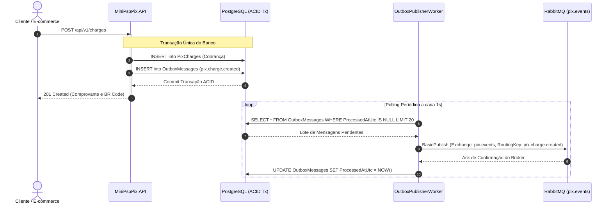

# Pilar 5: Transactional Outbox Pattern & RabbitMQ

Ao desenvolver microsserviços e sistemas de pagamentos distribuídos, um dos problemas mais comuns e perigosos é o **Problema de Escrita Dupla (*Dual-Write Problem*)**.

---

## 💥 O Problema de Escrita Dupla (Dual-Write)

Considere a tentativa ingênua de salvar uma transação no banco e publicar um evento no broker de mensagens sequencialmente:

```csharp
// ❌ ANTI-PATTERN: Escrita Dupla Ingênua
await _dbContext.SaveChangesAsync(); // 1. Grava no banco
await _rabbitMq.PublishAsync(event); // 2. Publica no RabbitMQ
```

Duas falhas graves podem acontecer:
1. **Falha após o Banco**: Se o processo cair, perder a rede com o RabbitMQ ou sofrer timeout após a linha 1, o pagamento foi gravado, mas **nenhum evento é emitido** para o sistema parceiro ou webhooks (Perda de Mensagem).
2. **Falha invertida**: Se publicarmos antes do commit e o banco rejeitar por violação de constraint ou deadlock, o evento foi emitido, mas o pagamento **não existe no banco** (Mensagem Fantasma).

---

## 📦 A Solução: Transactional Outbox Pattern

O padrão **Transactional Outbox** garante que a gravação do estado de negócio e a intenção de publicação ocorram sob a **mesma transação ACID relacional**:



---

## 🗄️ Estrutura da Entidade `OutboxMessage`

A entidade é mapeada no banco de dados com a seguinte estrutura:

```csharp
public class OutboxMessage : BaseEntity, IAggregateRoot
{
    public string EventType { get; private set; }       // Ex: "pix.payment.received"
    public string PayloadJson { get; private set; }     // Conteúdo JSON serializado
    public DateTime? ProcessedAtUtc { get; private set; }// Data de envio ao broker
    public int RetryCount { get; private set; }         // Contador de retentativas
    public string? LastError { get; private set; }      // Última exceção capturada
}
```

---

## ⚙️ Funcionamento do `OutboxPublisherWorker`

O serviço de segundo plano (`BackgroundService`):
1. Cria um escopo de injeção de dependências (`_serviceProvider.CreateScope()`).
2. Consulta o repositório por lotes não processados: `GetUnprocessedBatchAsync(20)`.
3. Para cada mensagem:
   * Publica via `IEventPublisher` no RabbitMQ com propriedades persistentes (`Persistent = true`).
   * Marca a mensagem como processada: `MarkAsProcessedAsync(id)`.
   * Caso o broker esteja indisponível, registra o erro no banco e incrementa o `RetryCount` para a próxima iteração.

---

## 🐰 Topologia no RabbitMQ

* **Exchange Principal**: `pix.events`
  * Tipo: `topic`
  * Durável: `durable = true`
* **Routing Keys Emitidas**:
  * `pix.charge.created`: Disparado na emissão da cobrança com BR Code.
  * `pix.payment.received`: Disparado na confirmação e liquidação inbound do pagamento.
  * `pix.payout.completed`: Disparado na liquidação com sucesso de uma ordem de saque/saída.
* **Garantia de Entrega**: *At-Least-Once Delivery* (Pelo menos uma vez). Os consumidores externos devem ser idempotentes para processar eventuais reentregas.
