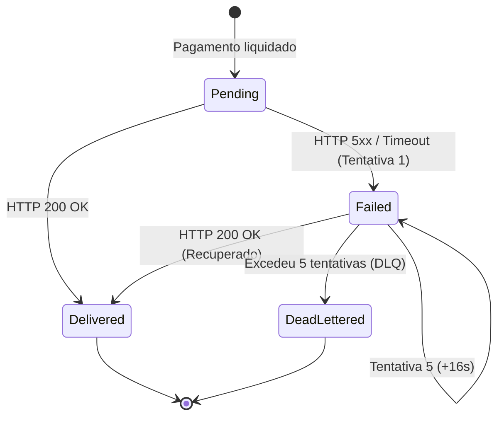

# Pilar 6: Webhooks com Assinatura HMAC-SHA256 & DLQ

Quando um pagamento Pix é liquidado, o PSP notifica o sistema do comerciante através de uma requisição HTTP `POST` (*Webhook*). Como essa comunicação trafega pela internet pública, é mandatório garantir **Autenticidade**, **Integridade** e **Proteção contra Ataques de Replay**, além de alta resiliência na entrega.

---

## 🔐 Assinatura Criptográfica HMAC-SHA256

Cada comerciante possui uma chave secreta (`SecretKey`) gerada no cadastro do webhook. O Mini-PSP envia um cabeçalho customizado em cada despacho:

$$\text{Header: } \texttt{X-Signature: t=\{timestamp\},v1=\{hmac\_sha256\}}$$

### Como a Assinatura é Gerada (`HmacSignerService`)

1. **Timestamp**: Obtém o Unix Timestamp em segundos (`DateTimeOffset.UtcNow.ToUnixTimeSeconds()`).
2. **Payload Assinado**: Concatena o carimbo de tempo com o corpo JSON:
   $$\text{Mensagem} = \texttt{"\{timestamp\}.\{payloadJson\}"}$$
3. **Cálculo HMAC**: Executa `HMACSHA256` utilizando a chave secreta do lojista:
   $$\text{v1} = \text{Convert.ToHexString}(\text{HMACSHA256}(\text{Key}, \text{Mensagem})).\text{ToLowerInvariant}()$$

### Como o Comerciante Valida a Notificação

1. Extrai `t` e `v1` do cabeçalho `X-Signature`.
2. **Prevenção contra Ataques de Replay**:
   * Compara `t` com a hora atual do servidor receptor.
   * Se a diferença for superior à janela de tolerância (padrão: **5 minutos**), a notificação é sumariamente descartada como suspeita de interceptação maliciosa.
3. **Validação de Integridade e Autenticidade**:
   * Recalcula o HMAC do corpo recebido com sua `SecretKey`.
   * Se o hash calculado for estritamente igual ao `v1`, o lojista tem a garantia matemática de que:
     * A notificação foi gerada autenticamente pelo Mini-PSP (somente o PSP e o lojista possuem a chave).
     * Nenhum caractere do JSON foi violado por interceptadores intermediários (*Man-in-the-Middle*).

---

## 📈 Política de Retentativas com Backoff Exponencial

Se o servidor do parceiro estiver temporariamente fora do ar, reiniciar ou responder com erro HTTP `5xx` ou timeout:

### Fórmula de Atraso Exponencial

A cada falha registrada por `delivery.RecordFailure(...)`, o próximo horário de reenvio é programado:
$$\text{Delay em Segundos} = 2^{(\text{Tentativa} - 1)} \times 2$$

* **1ª Falha**: Reenvio após **2 segundos** ($2^0 \times 2$)
* **2ª Falha**: Reenvio após **4 segundos** ($2^1 \times 2$)
* **3ª Falha**: Reenvio após **8 segundos** ($2^2 \times 2$)
* **4ª Falha**: Reenvio após **16 segundos** ($2^3 \times 2$)
* **5ª Falha**: Esgotadas as 5 tentativas programadas $\rightarrow$ A entrega transiciona para `Status = WebhookDeliveryStatus.DeadLettered`.

---

## 💀 Dead Letter Queue (DLQ)

Quando a entrega atinge o status `DeadLettered`:

* O `NextRetryAtUtc` é anulado para cessar o envio contra o servidor indisponível.
* A mensagem permanece persistida para auditoria técnica na tabela `WebhookDeliveries` e pode ser encaminhada para a fila RabbitMQ `pix.webhook.dlq`.
* Permite que operadores de suporte investiguem o incidente e realizem o reprocessamento manual assim que o parceiro restabelecer a infraestrutura.
