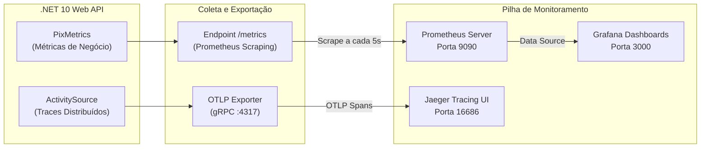

# Pilar 7: Observabilidade & Testes de Carga (k6)

Em plataformas financeiras de missão crítica, a observabilidade contínua e a capacidade de comprovar a performance sob estresse são requisitos inegociáveis.

O **Mini-PSP Pix Simulado** integra telemetria nativa com **OpenTelemetry**, exportação para **Prometheus**, rastreamento distribuído com **Jaeger**, dashboards pré-configurados no **Grafana** e um script de teste de carga pronto para execução com **k6**.

---

## 📊 Arquitetura de Observabilidade



---

## 📈 Métricas de Negócio (`PixMetrics`)

As métricas são instrumentadas via classe `PixMetrics` utilizando a API nativa de alta performance `System.Diagnostics.Metrics.Meter`:

| Nome da Métrica | Tipo | Descrição Operacional |
| :--- | :--- | :--- |
| `pix_charges_created_total` | Counter | Total de cobranças Pix emitidas com BR Code. |
| `pix_payments_processed_total` | Counter | Total de pagamentos Pix inbound liquidados. |
| `pix_payouts_requested_total` | Counter | Total de ordens de saque Pix requisitadas. |
| `pix_idempotent_replays_total` | Counter | Volume de requisições atendidas diretamente do cache de idempotência (`Idempotent-Replay: true`). |
| `pix_idempotent_conflicts_total` | Counter | Total de bloqueios por chave reutilizada com payload divergente (422) ou requisições paralelas (409). |
| `pix_double_spending_attempts_total` | Counter | Tentativas de gasto concorrente bloqueadas pelo controle otimista (`RowVersion`) ou saldo insuficiente. |
| `pix_webhooks_dispatched_total` | Counter | Total de notificações de webhook disparadas para comerciantes. |

---

## 🚀 Teste de Carga com k6 (`load-tests/k6-charges-load.js`)

O script k6 simula o ciclo completo de compra de um grande e-commerce em dias de pico (ex: Black Friday):

### Fases de Carga (Stages):
* **0s a 10s**: Rampa de aquecimento para **20 usuários virtuais (VUs)** concorrentes.
* **10s a 40s**: Estresse sustentado com **50 VUs simultâneos**.
* **40s a 50s**: Rampa de desaceleração gradual.

### SLAs e Thresholds Estipulados:
* `http_req_failed < 1%`: Taxa de erro HTTP inferior a 1%.
* `http_req_duration p(95) < 150ms`: 95% das cobranças processadas em menos de 150 milissegundos.
* `http_req_duration p(99) < 300ms`: 99% das cobranças processadas em menos de 300 milissegundos.

### Ciclo por Iteração:
1. **Emissão da Cobrança**: `POST /api/v1/charges` gerando BR Code e SVG.
2. **Validação de Idempotência**: Reenvio imediato do mesmo payload com a mesma `Idempotency-Key` (validando resposta cached `201` com header `Idempotent-Replay`).
3. **Consulta de Status**: `GET /api/v1/charges/{txId}` verificando cobrança ativa.
4. **Liquidação Simulada**: `POST /api/v1/payments/simulation` confirmando o pagamento.

---

## 🏃 Como Executar o Teste de Carga

Com o ambiente em execução via Docker Compose:

```bash
# Executando via contêiner oficial do k6
docker run --rm -i --net=host grafana/k6 run - < load-tests/k6-charges-load.js
```

Ou se você tiver o binário do `k6` instalado localmente:
```bash
k6 run load-tests/k6-charges-load.js
```

Durante o teste, você pode acompanhar em tempo real o aumento na taxa de requisições por segundo (RPS), p95 e contadores de negócio no painel do **Grafana** em `http://localhost:3000` (usuário `admin` / senha `admin`).
